

<picture>
  <source media="(prefers-color-scheme: dark)" srcset="./assets/hero-dark.svg"/>
  <source media="(prefers-color-scheme: light)" srcset="./assets/hero-light.svg"/>
  
</picture>

 

 

<picture>
  <source media="(prefers-color-scheme: dark)" srcset="./assets/terminal-dark.svg"/>
  <source media="(prefers-color-scheme: light)" srcset="./assets/terminal-light.svg"/>
  
</picture>

<picture>
  <source media="(prefers-color-scheme: dark)" srcset="./assets/numbers-dark.svg"/>
  <source media="(prefers-color-scheme: light)" srcset="./assets/numbers-light.svg"/>
  
</picture>

 

<picture>
  <source media="(prefers-color-scheme: dark)" srcset="./assets/h-about-dark.svg"/>
  <source media="(prefers-color-scheme: light)" srcset="./assets/h-about-light.svg"/>
  
</picture>

<picture>
  <source media="(prefers-color-scheme: dark)" srcset="./assets/codecard-dark.svg"/>
  <source media="(prefers-color-scheme: light)" srcset="./assets/codecard-light.svg"/>
  
</picture>

 

<picture>
  <source media="(prefers-color-scheme: dark)" srcset="./assets/h-stack-dark.svg"/>
  <source media="(prefers-color-scheme: light)" srcset="./assets/h-stack-light.svg"/>
  
</picture>

<picture>
  <source media="(prefers-color-scheme: dark)" srcset="./assets/orbit-dark.svg"/>
  <source media="(prefers-color-scheme: light)" srcset="./assets/orbit-light.svg"/>
  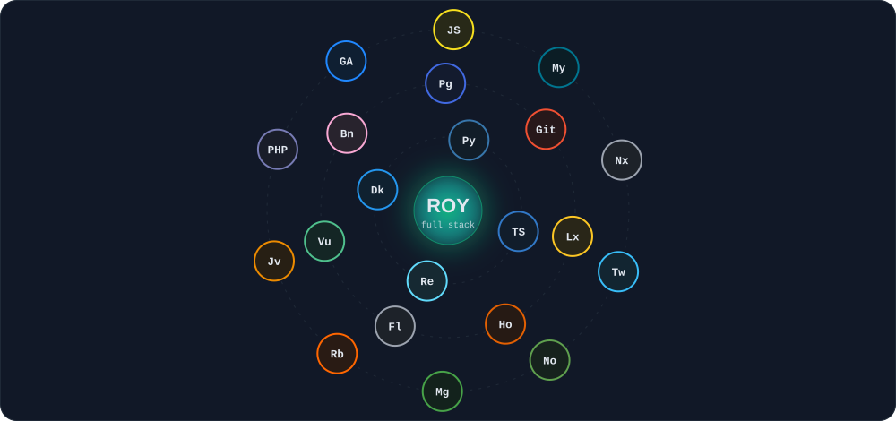
</picture>

<picture>
  <source media="(prefers-color-scheme: dark)" srcset="./assets/stack-dark.svg"/>
  <source media="(prefers-color-scheme: light)" srcset="./assets/stack-light.svg"/>
  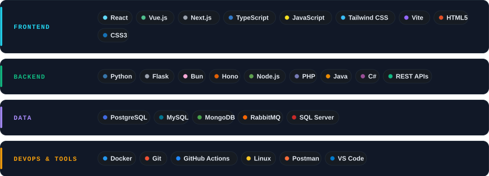
</picture>

 

<picture>
  <source media="(prefers-color-scheme: dark)" srcset="./assets/h-projects-dark.svg"/>
  <source media="(prefers-color-scheme: light)" srcset="./assets/h-projects-light.svg"/>
  
</picture>

<a href="https://github.com/Roy-x24/plataforma-reservas-turisticas">
<picture>
  <source media="(prefers-color-scheme: dark)" srcset="./assets/card-reservas-dark.svg"/>
  <source media="(prefers-color-scheme: light)" srcset="./assets/card-reservas-light.svg"/>
  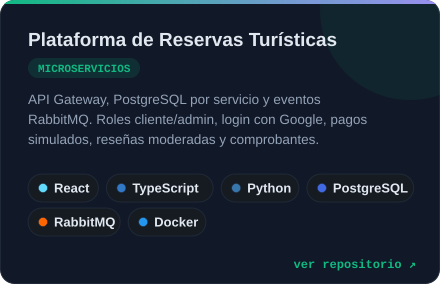
</picture>
</a>
<a href="https://github.com/Roy-x24/sistema-ddc-inmobiliario">
<picture>
  <source media="(prefers-color-scheme: dark)" srcset="./assets/card-ddc-inmo-dark.svg"/>
  <source media="(prefers-color-scheme: light)" srcset="./assets/card-ddc-inmo-light.svg"/>
  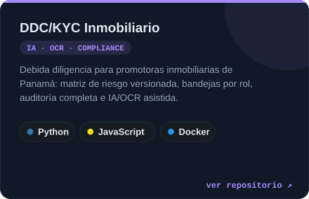
</picture>
</a>
 
<a href="https://github.com/Roy-x24/ddc-kyc-sistema">
<picture>
  <source media="(prefers-color-scheme: dark)" srcset="./assets/card-ddc-kyc-dark.svg"/>
  <source media="(prefers-color-scheme: light)" srcset="./assets/card-ddc-kyc-light.svg"/>
  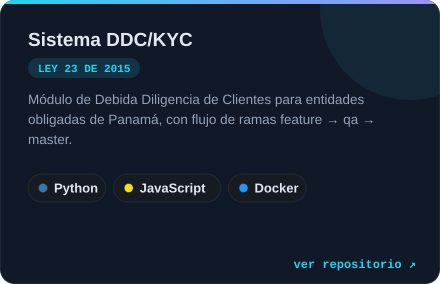
</picture>
</a>
<a href="https://github.com/Roy-x24/PokePelea">
<picture>
  <source media="(prefers-color-scheme: dark)" srcset="./assets/card-pokepelea-dark.svg"/>
  <source media="(prefers-color-scheme: light)" srcset="./assets/card-pokepelea-light.svg"/>
  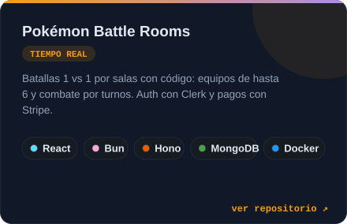
</picture>
</a>
 
<a href="https://github.com/Roy-x24/checkers">
<picture>
  <source media="(prefers-color-scheme: dark)" srcset="./assets/card-checkers-dark.svg"/>
  <source media="(prefers-color-scheme: light)" srcset="./assets/card-checkers-light.svg"/>
  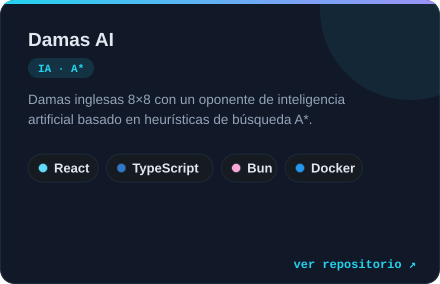
</picture>
</a>
<a href="https://github.com/Roy-x24/pollclass">
<picture>
  <source media="(prefers-color-scheme: dark)" srcset="./assets/card-pollclass-dark.svg"/>
  <source media="(prefers-color-scheme: light)" srcset="./assets/card-pollclass-light.svg"/>
  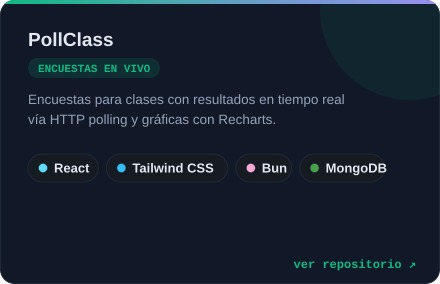
</picture>
</a>
 

 

<picture>
  <source media="(prefers-color-scheme: dark)" srcset="./assets/h-arch-dark.svg"/>
  <source media="(prefers-color-scheme: light)" srcset="./assets/h-arch-light.svg"/>
  
</picture>

<a href="https://github.com/Roy-x24/plataforma-reservas-turisticas">
<picture>
  <source media="(prefers-color-scheme: dark)" srcset="./assets/arch-dark.svg"/>
  <source media="(prefers-color-scheme: light)" srcset="./assets/arch-light.svg"/>
  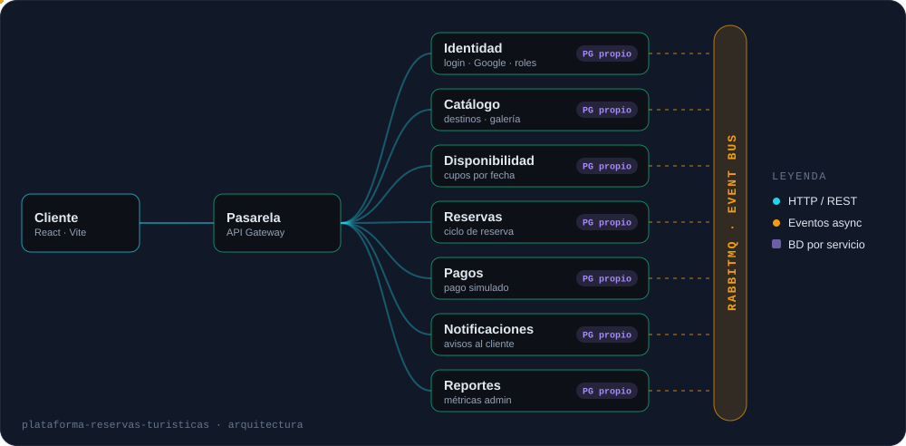
</picture>
</a>

 

<picture>
  <source media="(prefers-color-scheme: dark)" srcset="./assets/h-exp-dark.svg"/>
  <source media="(prefers-color-scheme: light)" srcset="./assets/h-exp-light.svg"/>
  
</picture>

<picture>
  <source media="(prefers-color-scheme: dark)" srcset="./assets/exp-ditic-dark.svg"/>
  <source media="(prefers-color-scheme: light)" srcset="./assets/exp-ditic-light.svg"/>
  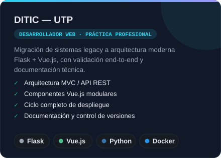
</picture>
<picture>
  <source media="(prefers-color-scheme: dark)" srcset="./assets/exp-ayudinga-dark.svg"/>
  <source media="(prefers-color-scheme: light)" srcset="./assets/exp-ayudinga-light.svg"/>
  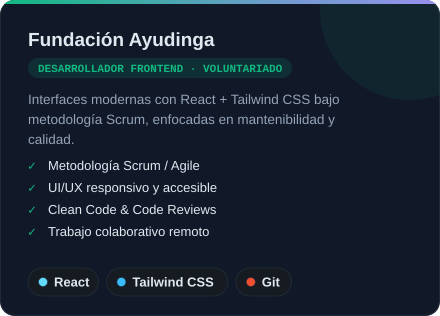
</picture>

 

<picture>
  <source media="(prefers-color-scheme: dark)" srcset="./assets/h-edu-dark.svg"/>
  <source media="(prefers-color-scheme: light)" srcset="./assets/h-edu-light.svg"/>
  
</picture>

<picture>
  <source media="(prefers-color-scheme: dark)" srcset="./assets/education-dark.svg"/>
  <source media="(prefers-color-scheme: light)" srcset="./assets/education-light.svg"/>
  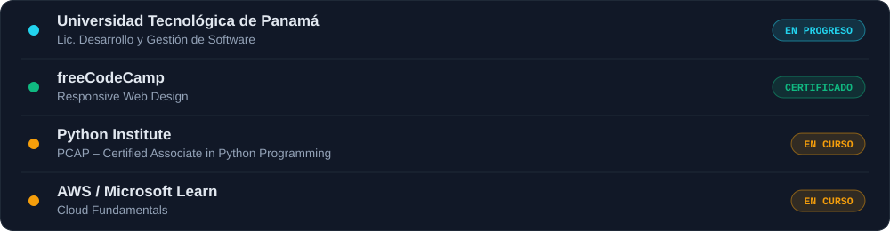
</picture>

 

<picture>
  <source media="(prefers-color-scheme: dark)" srcset="./assets/h-flow-dark.svg"/>
  <source media="(prefers-color-scheme: light)" srcset="./assets/h-flow-light.svg"/>
  
</picture>

<picture>
  <source media="(prefers-color-scheme: dark)" srcset="./assets/pipeline-dark.svg"/>
  <source media="(prefers-color-scheme: light)" srcset="./assets/pipeline-light.svg"/>
  
</picture>

<picture>
  <source media="(prefers-color-scheme: dark)" srcset="./assets/principles-dark.svg"/>
  <source media="(prefers-color-scheme: light)" srcset="./assets/principles-light.svg"/>
  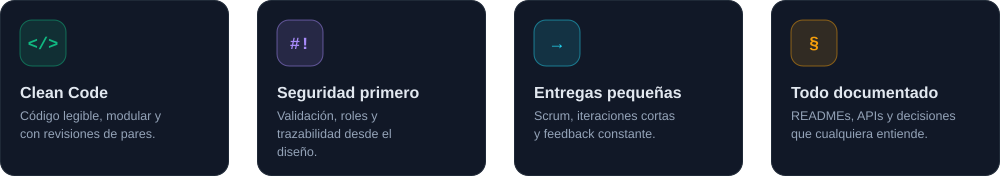
</picture>

 

<picture>
  <source media="(prefers-color-scheme: dark)" srcset="./assets/h-loading-dark.svg"/>
  <source media="(prefers-color-scheme: light)" srcset="./assets/h-loading-light.svg"/>
  
</picture>

<picture>
  <source media="(prefers-color-scheme: dark)" srcset="./assets/loading-dark.svg"/>
  <source media="(prefers-color-scheme: light)" srcset="./assets/loading-light.svg"/>
  
</picture>

 

<picture>
  <source media="(prefers-color-scheme: dark)" srcset="./assets/h-stats-dark.svg"/>
  <source media="(prefers-color-scheme: light)" srcset="./assets/h-stats-light.svg"/>
  
</picture>

<picture>
  <source media="(prefers-color-scheme: dark)" srcset="https://raw.githubusercontent.com/Roy-x24/Roy-x24/output/stats-dark.svg"/>
  <source media="(prefers-color-scheme: light)" srcset="https://raw.githubusercontent.com/Roy-x24/Roy-x24/output/stats-light.svg"/>
  
</picture>
<picture>
  <source media="(prefers-color-scheme: dark)" srcset="https://raw.githubusercontent.com/Roy-x24/Roy-x24/output/top-langs-dark.svg"/>
  <source media="(prefers-color-scheme: light)" srcset="https://raw.githubusercontent.com/Roy-x24/Roy-x24/output/top-langs-light.svg"/>
  
</picture>

<picture>
  <source media="(prefers-color-scheme: dark)" srcset="https://streak-stats.demolab.com?user=Roy-x24&background=0d1117&border=1f2937&stroke=1f2937&ring=10b981&fire=f59e0b&currStreakNum=22d3ee&sideNums=e2e8f0&currStreakLabel=10b981&sideLabels=e2e8f0&dates=64748b&border_radius=14"/>
  <source media="(prefers-color-scheme: light)" srcset="https://streak-stats.demolab.com?user=Roy-x24&background=ffffff&border=e2e8f0&stroke=e2e8f0&ring=059669&fire=f59e0b&currStreakNum=0891b2&sideNums=0f172a&currStreakLabel=059669&sideLabels=0f172a&dates=64748b&border_radius=14"/>
  
</picture>

 

<picture>
  <source media="(prefers-color-scheme: dark)" srcset="./assets/h-skills-dark.svg"/>
  <source media="(prefers-color-scheme: light)" srcset="./assets/h-skills-light.svg"/>
  
</picture>

<picture>
  <source media="(prefers-color-scheme: dark)" srcset="./assets/skills-dark.svg"/>
  <source media="(prefers-color-scheme: light)" srcset="./assets/skills-light.svg"/>
  
</picture>

 

<picture>
  <source media="(prefers-color-scheme: dark)" srcset="./assets/h-snake-dark.svg"/>
  <source media="(prefers-color-scheme: light)" srcset="./assets/h-snake-light.svg"/>
  
</picture>

<picture>
  <source media="(prefers-color-scheme: dark)" srcset="https://raw.githubusercontent.com/Roy-x24/Roy-x24/output/github-contribution-grid-snake-dark.svg"/>
  <source media="(prefers-color-scheme: light)" srcset="https://raw.githubusercontent.com/Roy-x24/Roy-x24/output/github-contribution-grid-snake.svg"/>
  
</picture>

 

<b>📂 Más repositorios</b> — laboratorios, prácticas y proyectos académicos

 

| Repositorio | Lenguaje | Descripción |
|:---|:---:|:---|
| [`gestor-tareas-estudio`](https://github.com/Roy-x24/gestor-tareas-estudio) | TypeScript | Gestor de tareas de estudio |
| [`agenda-citas`](https://github.com/Roy-x24/agenda-citas) | PHP | Agenda de citas |
| [`roy-portfolio`](https://github.com/Roy-x24/roy-portfolio) | JavaScript | Portafolio personal (Next.js) · [en vivo](https://roy-portfolio-peach.vercel.app) |
| [`qaLabMcpv2`](https://github.com/Roy-x24/qaLabMcpv2) | Python | Laboratorio MCP — herramientas de QA |
| [`2026-1GS241-barrera-roy`](https://github.com/Roy-x24/2026-1GS241-barrera-roy) | TypeScript | Trabajo universitario |
| [`Lab5SFTVI`](https://github.com/Roy-x24/Lab5SFTVI) | Java | Laboratorio Java |
| [`EjemploValidacionesRoy`](https://github.com/Roy-x24/EjemploValidacionesRoy) | PHP | Validaciones en PHP |
| [`apiSemestralIV`](https://github.com/Roy-x24/apiSemestralIV) | C# | API semestral |
| [`frontendSoftwareV`](https://github.com/Roy-x24/frontendSoftwareV) | CSS | Frontend de Software V |

 

<picture>
  <source media="(prefers-color-scheme: dark)" srcset="./assets/quote-dark.svg"/>
  <source media="(prefers-color-scheme: light)" srcset="./assets/quote-light.svg"/>
  
</picture>

<a href="mailto:roybarrera508@gmail.com">
<picture>
  <source media="(prefers-color-scheme: dark)" srcset="./assets/contact-dark.svg"/>
  <source media="(prefers-color-scheme: light)" srcset="./assets/contact-light.svg"/>
  
</picture>
</a>

<picture>
  <source media="(prefers-color-scheme: dark)" srcset="./assets/footer-dark.svg"/>
  <source media="(prefers-color-scheme: light)" srcset="./assets/footer-light.svg"/>
  
</picture>
